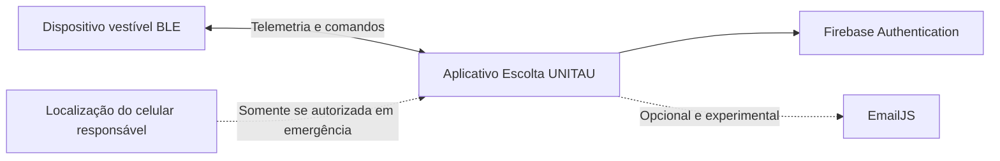

# Escolta UNITAU

Protótipo acadêmico funcional de monitoramento de proximidade infantil por Bluetooth Low Energy, desenvolvido como Trabalho de Conclusão de Curso em Engenharia da Computação na Universidade de Taubaté (UNITAU).

> O Escolta UNITAU não é um produto comercial, equipamento certificado nem substituto da supervisão de um responsável. As distâncias exibidas são estimativas experimentais baseadas em RSSI e podem variar conforme o ambiente, obstáculos, corpo humano e características do celular.

## Objetivo

O protótipo investiga como um dispositivo vestível BLE e um aplicativo móvel podem ajudar o responsável a perceber afastamentos e acionamentos manuais de emergência. A experiência foi desenhada para apresentar os estados de maneira simples, sem afirmar direção ou localização exata da criança.

## Estado atual

_Atualizado em 24 de setembro de 2026._

- Aplicativo React Native com Expo SDK 54 e TypeScript.
- Autenticação de acesso com Firebase.
- Conexão automática ao dispositivo `ESCOLTA_BLE`.
- Sentinela com tentativa imediata de reconexão e janela de tolerância antes da emergência.
- Sirene e vibração locais, com confirmação humana para encerrar a emergência.
- Distância estimada na Central; RSSI restrito ao código técnico/Telemetria.
- Histórico de ocorrências persistido localmente.
- Preferências de tema, reconexão, alertas, vibração, animações e localização opcional.
- E-mail de emergência mantido como canal experimental para ensaios controlados.
- Indicador discreto da bateria do dispositivo no cabeçalho, com percentual,
  tensão, carregamento e avisos por faixa.
- Telemetria técnica preservada no código, mas fora da navegação comum.

O hardware vestível já utiliza a **Seeed Studio XIAO nRF52840 Sense**. O circuito foi montado, soldado e validado com buzzer funcional, transistor P2N2222A, resistores de 1 kΩ e 10 kΩ, diodo 1N4007 e botão físico de emergência.

A bateria LiPo 3,7 V/180 mAh com proteção PCM/BMS já está ligada por conector, alimenta a XIAO e pode ser recarregada pela USB-C da placa. A leitura interna foi comparada com multímetro e apresentou diferença de apenas 0,01 V. O primeiro ensaio registrou 11 h 10 min de funcionamento entre 90% e 5%, com autonomia total preliminar projetada próxima de 13 horas.

A primeira estrutura foi impressa e usada para revisar encaixes, passantes e retenções. A revisão atual da caixa compacta mantém acesso à USB-C, botão, LED, saída acústica e região da antena, e está pronta para uma nova impressão de validação. O motor de vibração foi retirado do escopo atual para reduzir volume, consumo e complexidade de montagem.

> O bloqueio temporário usado no ensaio de autonomia foi removido em 17 de setembro de 2026. O aplicativo e o firmware voltaram à operação normal, com buzzer, sirene, vibração e notificações de emergência ativos conforme o estado e as preferências.

### Situação do hardware

- [x] XIAO nRF52840 Sense programada e reconhecida pelo aplicativo.
- [x] Comunicação BLE e comandos do buzzer validados.
- [x] Transistor, resistores, diodo e buzzer soldados.
- [x] Botão físico de emergência soldado e validado.
- [x] Conector da bateria LiPo soldado e isolado.
- [x] Validar alimentação e recarga pela XIAO.
- [x] Exibir percentual, tensão e estado de carga no aplicativo.
- [x] Executar o primeiro ensaio alimentado somente pela bateria.
- [ ] Repetir o ensaio de autonomia para calcular média e variação.
- [ ] Medir separadamente a autonomia em espera.
- [x] Definir dimensões e encaixes da estrutura vestível.
- [x] Realizar a primeira impressão e registrar as correções necessárias.
- [ ] Imprimir e validar a revisão compacta da caixa vestível.

## Navegação

- **Central:** estado atual, núcleo de proteção, distância estimada e cobertura do protótipo.
- **Protocolo:** orientações de uso e conduta durante atenção ou emergência.
- **Registros:** linha do tempo dos eventos relevantes.
- **Sistema:** perfil, criança, preferências, privacidade e canal experimental.

## Arquitetura resumida



O Telegram não integra mais o fluxo ativo porque um token dentro do aplicativo seria extraível. Uma evolução profissional de contatos de confiança deverá usar backend autenticado e notificações push.

## Estrutura do repositório

```text
├── src/                         # Aplicativo React Native/Expo
├── modules/escolta-sentinela/   # Serviço Android nativo de monitoração
├── firmware/                    # Firmwares atual e legado
│   ├── xiao_escolta_ble/
│   └── esp32_escolta_ble/
├── hardware/case_3d/            # Fonte OpenSCAD e STL atuais
├── docs/
│   ├── cicted/                  # Resumos e revisões do evento
│   ├── produto/                 # Especificação, fluxos e diagramas
│   ├── prototipo/               # Fotografias do hardware
│   ├── tcc/                     # Texto acadêmico e modelos
│   └── testes/                  # Relatórios e ensaios
└── tools/                       # Utilitários de documentos e diagramas
```

Os fluxos e critérios de experiência estão documentados em:

- [`docs/produto/ESPECIFICACAO_PRODUTO_ESCOLTA_UNITAU.md`](docs/produto/ESPECIFICACAO_PRODUTO_ESCOLTA_UNITAU.md)
- [`docs/produto/FLUXOS_CENTRAL_SENTINELA.md`](docs/produto/FLUXOS_CENTRAL_SENTINELA.md)
- [`docs/produto/imagens_montagem/01-transistor-resistores.png`](docs/produto/imagens_montagem/01-transistor-resistores.png)
- [`docs/produto/imagens_montagem/02-circuito-completo.png`](docs/produto/imagens_montagem/02-circuito-completo.png)
- [`docs/testes/ENSAIO_AUTONOMIA_BATERIA_2026-09-08.md`](docs/testes/ENSAIO_AUTONOMIA_BATERIA_2026-09-08.md)
- [`hardware/case_3d/PARA_IMPRIMIR_AGORA/`](hardware/case_3d/PARA_IMPRIMIR_AGORA/)

## Execução

O BLE depende de código nativo e não funciona no Expo Go. Use um aparelho físico com development build:

```bash
npm install
npx expo run:android
```

Para iOS, será necessário um ambiente macOS com Xcode:

```bash
npx expo run:ios
```

## Autores

- Nicolas Venciguerra Men
- Rafael Gonçalves Dedini
- Engenharia da Computação — UNITAU

## Terminologia para apresentação

Use **protótipo acadêmico funcional**, **prova de conceito integrada**, **resultados dos ensaios** e **evolução futura**. Evite apresentar o sistema como produto pronto, solução infalível, rastreador ou dispositivo certificado.
