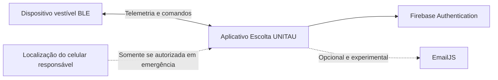

# Escolta UNITAU

Protótipo acadêmico funcional de monitoramento de proximidade infantil por Bluetooth Low Energy, desenvolvido como Trabalho de Conclusão de Curso em Engenharia da Computação na Universidade de Taubaté (UNITAU).

> O Escolta UNITAU não é um produto comercial, equipamento certificado nem substituto da supervisão de um responsável. As distâncias exibidas são estimativas experimentais baseadas em RSSI e podem variar conforme o ambiente, obstáculos, corpo humano e características do celular.

## Objetivo

O protótipo investiga como um dispositivo vestível BLE e um aplicativo móvel podem ajudar o responsável a perceber afastamentos e acionamentos manuais de emergência. A experiência foi desenhada para apresentar os estados de maneira simples, sem afirmar direção ou localização exata da criança.

## Estado atual

_Estado documental atualizado em 4 de novembro de 2026; distribuição do APK de 17/10 preservada._

**Escolta UNITAU 1.0.1 (Android, código 2) é a versão oficial desta rodada do protótipo acadêmico.**
APK release com JavaScript incorporado, assinatura original e Firebase/Google
configurados; funciona sem Expo/Metro. Atualizado no Samsung Galaxy S24 Ultra
sem desinstalar a oficial nem limpar seus dados. O aplicativo Teste foi removido
do celular; fontes e backups de desenvolvimento foram preservados.

A checagem instalada sem servidor aprovou, por relato do usuário, login Google,
continuidade ao remover de Recentes/bloquear a tela e perda de conexão com
reconexão, emergência retida e confirmação de segurança aceita pela placa.
O candidato com o mesmo bundle já havia passado pelos roteiros de amarelo,
vermelho, retorno, relatório e login. **211 testes automatizados e tipagem
aprovados** na preparação. Isso não certifica o produto ou outros aparelhos.

Registro de assinatura, APK, hashes, instalação, testes e limitações:
[oficial 1.0.1](docs/auditoria/PREPARACAO_OFICIAL_VALIDADA_2026-10-17.md).
[Compilação EAS](https://expo.dev/accounts/nicolas_venciguerra_men/projects/escolta-unitau/builds/622eb96d-11d7-4f0e-81bf-f26d546ffb7c).
APK e backups são artefatos de distribuição locais, não arquivos do histórico Git.

**Atualização de 04/11/2026:** o usuário confirmou o reparo e a aprovação do
botão físico na oficial. A data exata do ensaio não foi informada; trata-se de
aceite relatado, sem novo registro instrumental anexado.
O texto acadêmico foi atualizado e salvo no Drive em Word e PDF de 41 páginas
em 04/11; consultar [a revisão e os links](docs/tcc/README.md).
**Pendências:** revisão final dos autores/orientador; medir autonomia na
configuração atual e comportamento de bateria baixa. Não haverá nova alteração
de comportamento sem falha observada ou nova solicitação. Relatórios antigos em
`docs/auditoria` e `docs/testes` registram etapas históricas, não o estado atual.

- Aplicativo React Native com Expo SDK 54 e TypeScript.
- Autenticação de acesso com Firebase.
- Conexão automática ao dispositivo `ESCOLTA_BLE`.
- Sentinela com tentativa imediata de reconexão e janela de tolerância antes da emergência.
- Sirene e vibração locais, com confirmação humana para encerrar a emergência.
- Distância estimada na Central; RSSI restrito ao código técnico/Telemetria.
- Histórico de ocorrências persistido localmente.
- Preferências de tema, reconexão, alertas, vibração, animações e localização opcional.
- E-mail de emergência opcional, dependente de internet e sem garantia de entrega.
- Indicador discreto da bateria do dispositivo no cabeçalho, com percentual,
  tensão, carregamento e avisos por faixa.
- Telemetria técnica preservada no código, mas fora da navegação comum.

O hardware vestível já utiliza a **Seeed Studio XIAO nRF52840 Sense**. O circuito foi montado, soldado e validado com buzzer funcional, transistor P2N2222A, resistores de 1 kΩ e 10 kΩ, diodo 1N4007 e botão físico de emergência.

A bateria LiPo 3,7 V/180 mAh com proteção PCM/BMS já está ligada por conector, alimenta a XIAO e pode ser recarregada pela USB-C da placa. A leitura interna foi comparada com multímetro e apresentou diferença de apenas 0,01 V naquele ensaio. O primeiro ciclo registrou 11 h 10 min entre 90% e 5% estimados, com alertas automáticos bloqueados. Isso não comprova autonomia total nem autonomia sob alarmes/reconexões; é necessário repetir os ensaios.

A caixa foi impressa, montada e parafusada pelo usuário. O kit digital atual está em `hardware/case_3d/PARA_IMPRIMIR_AGORA`. A XIAO ensaiada usa a variante `xiao-p5-r4-d1-k2-w1`, com rádio solicitado +4 dBm, filtro Kalman e watchdog de comunicação; sua compilação exige os opt-ins descritos em `firmware/README.md`. A calibração foi aprovada no ambiente ensaiado, não como fronteira métrica universal. O motor de vibração foi retirado do vestível; a vibração é do celular.

> O bloqueio temporário usado no ensaio de autonomia foi removido em 17 de setembro de 2026. O aplicativo e o firmware voltaram à operação normal, com buzzer, sirene, vibração e notificações de emergência ativos conforme o estado e as preferências.

### Situação do hardware

- [x] XIAO nRF52840 Sense programada e reconhecida pelo aplicativo.
- [x] Comunicação BLE e comandos do buzzer validados.
- [x] Transistor, resistores, diodo e buzzer soldados.
- [x] Reparar fios do botão e repetir a validação física na oficial (aceite do usuário informado em 04/11/2026).
- [x] Conector da bateria LiPo soldado e isolado.
- [x] Validar alimentação e recarga pela XIAO.
- [x] Exibir percentual, tensão e estado de carga no aplicativo.
- [x] Executar o primeiro ensaio alimentado somente pela bateria.
- [ ] Repetir o ensaio de autonomia para calcular média e variação.
- [ ] Medir separadamente a autonomia em espera.
- [x] Definir dimensões e encaixes da estrutura vestível.
- [x] Realizar a primeira impressão e registrar as correções necessárias.
- [x] Imprimir e montar a revisão da caixa vestível (retorno do usuário).
- [x] Validar os fluxos integrados desta rodada e instalar a oficial sem Metro.

## Navegação

- **Central:** estado atual, núcleo de proteção, distância estimada e condição do enlace.
- **Protocolo:** orientações de uso e conduta durante atenção ou emergência.
- **Registros:** linha do tempo dos eventos relevantes.
- **Sistema:** perfil, criança, preferências, privacidade e e-mail opcional para alertas.

### Ensaio de proximidade com a caixa fechada

Ferramenta interna oculta na oficial e em qualquer APK release. Para desenvolvimento,
exige cliente Teste, `__DEV__` e `EXPO_PUBLIC_ENABLE_INTERNAL_TOOLS=true`; consultar
[ativação e limites](docs/auditoria/INTERFACE_DE_USO_APK_2026-10-17.md).
No cliente de desenvolvimento habilitado, selecionar
a distância real medida com trena (1 a 15 m, de metro em metro). A tela aguarda 10 s e registra 30
notificações com leituras novas de RSSI, estimativa e estado; guarda até 100 ensaios
e compartilha o histórico como texto CSV. Não altera limites nem silencia alertas.
Uma casa decimal na estimativa não significa precisão de 10 cm.
Procedimento e limitações: [ensaio de proximidade](docs/testes/ENSAIO_PROXIMIDADE_CAIXA_FECHADA.md).
Validação local: `node --test tools/test-proximity-trial.cjs tools/test-proximity-ble.cjs`
e `node node_modules/typescript/bin/tsc --noEmit`.

## Arquitetura resumida



O Telegram não integra mais o fluxo ativo porque um token dentro do aplicativo seria extraível. Uma evolução profissional de contatos de confiança deverá usar backend autenticado e notificações push.

## Estrutura do repositório

```text
├── src/                         # Aplicativo React Native/Expo
├── modules/escolta-sentinela/   # Serviço Android de primeiro plano e alarme
├── modules/escolta-auth/        # Ponte nativa Android para login Google
├── firmware/                    # Firmwares atual e legado
│   ├── xiao_escolta_ble/
│   └── esp32_escolta_ble/
├── hardware/case_3d/            # Fonte OpenSCAD e STL atuais
├── docs/
│   ├── cicted/                  # Resumos e revisões do evento
│   ├── produto/                 # Especificação, fluxos e diagramas
│   ├── prototipo/               # Fotografias do hardware
│   ├── tcc/                     # Texto acadêmico e modelos
│   └── testes/                  # Relatórios e ensaios
└── tools/                       # Utilitários de documentos e diagramas
```

Os fluxos e critérios de experiência estão documentados em:

- [`docs/produto/ESPECIFICACAO_PRODUTO_ESCOLTA_UNITAU.md`](docs/produto/ESPECIFICACAO_PRODUTO_ESCOLTA_UNITAU.md)
- [`docs/produto/FLUXOS_CENTRAL_SENTINELA.md`](docs/produto/FLUXOS_CENTRAL_SENTINELA.md)
- [`docs/produto/imagens_montagem/01-transistor-resistores.png`](docs/produto/imagens_montagem/01-transistor-resistores.png)
- [`docs/produto/imagens_montagem/02-circuito-completo.png`](docs/produto/imagens_montagem/02-circuito-completo.png)
- [`docs/testes/ENSAIO_AUTONOMIA_BATERIA_2026-09-08.md`](docs/testes/ENSAIO_AUTONOMIA_BATERIA_2026-09-08.md)
- [`hardware/case_3d/PARA_IMPRIMIR_AGORA/`](hardware/case_3d/PARA_IMPRIMIR_AGORA/)

## Execução

O APK oficial funciona sem servidor e não usa Expo Go. Login exige internet;
o monitoramento BLE e alertas locais não dependem do Metro. Para desenvolver,
use aparelho físico e cliente de desenvolvimento separado, sem disputar a mesma
placa com a oficial.

O servidor Metro é usado no desenvolvimento; não existe servidor próprio de
distância no projeto. Firebase Authentication e o canal opcional de e-mail
continuam sendo serviços externos. O serviço Android não lê BLE por conta
própria: trabalha com o controlador JavaScript persistente e watchdog. Remover
de Recentes foi ensaiado, mas forçar parada ou restrições do Android podem
interromper o monitoramento; não há garantia de execução contínua em todo cenário.

```bash
npm install
npm test
npm run typecheck
```

Compilação Android Teste separada e comandos de desenvolvimento:

```bash
powershell -File tools/build-android.ps1 -Target Apk -TestApp -Online
npx expo start --dev-client --scheme escolta-teste
```

A futura compilação oficial usa o perfil EAS `oficial-validada` e a credencial
original existente; não criar outra chave para contornar falha de assinatura.
Não recarregar/gravar/atualizar durante proteção ativa. iOS não foi validado;
o serviço nativo de monitoramento deste projeto é Android.

## Autores

- Nicolas Venciguerra Men
- Rafael Gonçalves Dedini
- Engenharia da Computação — UNITAU

## Terminologia para apresentação

Use **protótipo acadêmico funcional**, **prova de conceito integrada**, **resultados dos ensaios** e **evolução futura**. Evite apresentar o sistema como produto pronto, solução infalível, rastreador ou dispositivo certificado.
