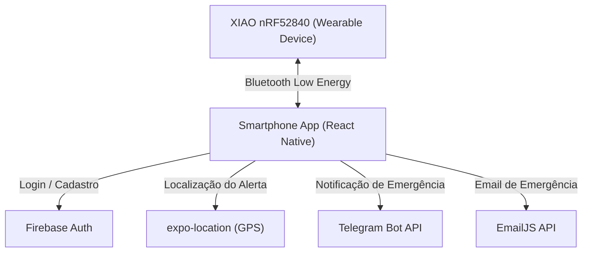

# 🛡️ Escolta UNITAU
**Sistema de Segurança Infantil via Bluetooth Low Energy**


---

## 📖 Sobre o Projeto
O **Escolta UNITAU** é um sistema de segurança infantil inovador desenvolvido como Trabalho de Conclusão de Curso (TCC). O projeto consiste em um dispositivo vestível (pulseira ou broche) equipado com Bluetooth Low Energy (BLE) que se conecta a um aplicativo móvel no smartphone do responsável.

O objetivo principal é monitorar a proximidade da criança. Caso a criança se afaste além do limite seguro ou pressione o botão de pânico no dispositivo, o sistema emite alertas imediatos para o responsável através de vibração e sirene no aplicativo, além de notificações automáticas via Telegram e E-mail, contendo a localização do smartphone (via Google Maps) no momento exato do disparo.

---

## ✨ Funcionalidades
- Monitoramento de proximidade via BLE (Bluetooth Low Energy)
- Alarme de pânico com vibração e sirene
- Notificações automáticas via Telegram e Email
- Localização GPS do smartphone no momento do alerta (link do Google Maps)
- Cerca virtual com 3 zonas (Seguro, Atenção, Pânico)
- Reconexão automática (Cão de Guarda)
- Histórico de alertas com exportação
- Tela de login com Firebase Authentication
- Manual de instruções integrado
- Design premium dark mode

---

## 🏗️ Arquitetura do Sistema



---

## 🛠️ Tecnologias Utilizadas

| Tecnologia | Descrição |
| --- | --- |
| **React Native + Expo SDK 54** | Desenvolvimento mobile multiplataforma. |
| **TypeScript** | Tipagem estática para JavaScript. |
| **Firebase Authentication** | Gerenciamento de login seguro dos usuários. |
| **Bluetooth Low Energy** | Comunicação com o wearable via `react-native-ble-plx`. |
| **expo-location** | Captura das coordenadas GPS para envio de socorro. |
| **Telegram Bot API** | Serviço de mensageria para envio de alertas. |
| **EmailJS** | Serviço para envio de e-mails emergenciais. |
| **Seeed Studio XIAO nRF52840 Sense** | Placa de desenvolvimento com Bluetooth integrado. |

---

## 📂 Estrutura do Projeto

Abaixo está a estrutura principal de diretórios referente ao código-fonte (`src/`):

```text
src/
├── hooks/
│   └── useEsp32Monitor.ts      # Lógica central de monitoramento BLE e Cão de Guarda
├── screens/
│   ├── AlertsScreen.tsx        # Tela de histórico de alertas
│   ├── AuthScreen.tsx          # Tela de login e registro
│   ├── DashboardScreen.tsx     # Tela principal de status e radar
│   ├── ManualScreen.tsx        # Manual de instruções do sistema
│   ├── PatrolScreen.tsx        # Tela de testes (LAB)
│   └── SettingsScreen.tsx      # Configurações do perfil e contatos de emergência
├── services/
│   ├── bleApi.ts               # Interface e comunicação Bluetooth com a placa
│   └── firebaseConfig.ts       # Configuração do Firebase
└── theme.ts                    # Paleta de cores premium
```

---

## 🚀 Como Executar

### Pré-requisitos
- Node.js instalado.
- Expo CLI.
- Dispositivo físico (Recomendado para testes de BLE e GPS).

### Passos
1. Clone o repositório:
   ```bash
   git clone https://github.com/NicolasVMen/app_tcc.git
   ```
2. Acesse a pasta do projeto:
   ```bash
   cd escolta-unitau
   ```
3. Instale as dependências:
   ```bash
   npm install
   ```
4. Execute o aplicativo (Como utiliza bibliotecas nativas, é recomendado fazer o build usando um dev client ou diretamente via plataforma):
   ```bash
   npx expo run:android
   # ou
   npx expo run:ios
   ```

---

## ⚙️ Hardware

O wearable é baseado no microcontrolador **Seeed Studio XIAO nRF52840 Sense**. Esta placa foi escolhida pelo seu formato compacto e suporte nativo ao Bluetooth 5.0 (BLE), tornando-a ideal para uso como acessório vestível.

- **Alimentação:** Funciona com uma bateria recarregável de baixo consumo.
- **Atuadores:** Um pequeno motor de vibração e um buzzer integrados para emissão de feedback físico e sonoro local (como confirmação de pareamento ou alarme acionado).
- **Entradas:** Botão de pânico tátil para a criança disparar o alarme manualmente.

---

## 👥 Autores

- **Nicolas Venciguerra Men**
- **Rafael Dedini**
- **Prof. Luis Fernando (Orientador)**
- **UNITAU — Universidade de Taubaté**

---

## 📄 Licença

Distribuído sob a licença MIT. Veja `LICENSE` para mais informações.
