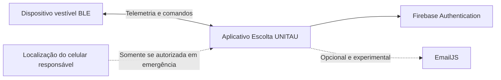

# Escolta UNITAU

Protótipo acadêmico funcional de monitoramento de proximidade infantil por Bluetooth Low Energy, desenvolvido como Trabalho de Conclusão de Curso em Engenharia da Computação na Universidade de Taubaté (UNITAU).

> O Escolta UNITAU não é um produto comercial, equipamento certificado nem substituto da supervisão de um responsável. As distâncias exibidas são estimativas experimentais baseadas em RSSI e podem variar conforme o ambiente, obstáculos, corpo humano e características do celular.

## Objetivo

O protótipo investiga como um dispositivo vestível BLE e um aplicativo móvel podem ajudar o responsável a perceber afastamentos e acionamentos manuais de emergência. A experiência foi desenhada para apresentar os estados de maneira simples, sem afirmar direção ou localização exata da criança.

## Estado atual

- Aplicativo React Native com Expo SDK 54 e TypeScript.
- Autenticação de acesso com Firebase.
- Conexão automática ao dispositivo `ESCOLTA_BLE`.
- Sentinela com tentativa imediata de reconexão e janela de tolerância antes da emergência.
- Sirene e vibração locais, com confirmação humana para encerrar a emergência.
- Distância estimada na Central; RSSI restrito ao código técnico/Telemetria.
- Histórico de ocorrências persistido localmente.
- Preferências de tema, reconexão, alertas, vibração, animações e localização opcional.
- E-mail de emergência mantido como canal experimental para ensaios controlados.
- Telemetria preservada no código, mas fora da navegação comum.

O hardware de bancada utiliza atualmente ESP32 DevKit V1 e buzzer. A integração com Seeed Studio XIAO nRF52840 Sense, bateria LiPo, motor de vibração, transistor e botão de pânico faz parte da próxima etapa experimental após a chegada e validação dos componentes.

## Navegação

- **Central:** estado atual, núcleo de proteção, distância estimada e cobertura do protótipo.
- **Protocolo:** orientações de uso e conduta durante atenção ou emergência.
- **Registros:** linha do tempo dos eventos relevantes.
- **Sistema:** perfil, criança, preferências, privacidade e canal experimental.

## Arquitetura resumida



O Telegram não integra mais o fluxo ativo porque um token dentro do aplicativo seria extraível. Uma evolução profissional de contatos de confiança deverá usar backend autenticado e notificações push.

## Estrutura principal

```text
src/
├── context/
│   └── AppPreferencesContext.tsx
├── hooks/
│   └── useEsp32Monitor.ts
├── screens/
│   ├── AlertsScreen.tsx
│   ├── AuthScreen.tsx
│   ├── DashboardScreen.tsx
│   ├── ManualScreen.tsx
│   ├── PatrolScreen.tsx       # Telemetria preservada, fora da navegação
│   └── SettingsScreen.tsx
├── services/
│   ├── bleApi.ts
│   └── firebaseConfig.ts
└── theme.ts
```

Os fluxos e critérios de experiência estão documentados em:

- [`docs/ESPECIFICACAO_PRODUTO_ESCOLTA_UNITAU.md`](docs/ESPECIFICACAO_PRODUTO_ESCOLTA_UNITAU.md)
- [`docs/FLUXOS_CENTRAL_SENTINELA.md`](docs/FLUXOS_CENTRAL_SENTINELA.md)

## Execução

O BLE depende de código nativo e não funciona no Expo Go. Use um aparelho físico com development build:

```bash
npm install
npx expo run:android
```

Para iOS, será necessário um ambiente macOS com Xcode:

```bash
npx expo run:ios
```

## Autores

- Nicolas Venciguerra Men
- Rafael Gonçalves Dedini
- Engenharia da Computação — UNITAU

## Terminologia para apresentação

Use **protótipo acadêmico funcional**, **prova de conceito integrada**, **resultados dos ensaios** e **evolução futura**. Evite apresentar o sistema como produto pronto, solução infalível, rastreador ou dispositivo certificado.
