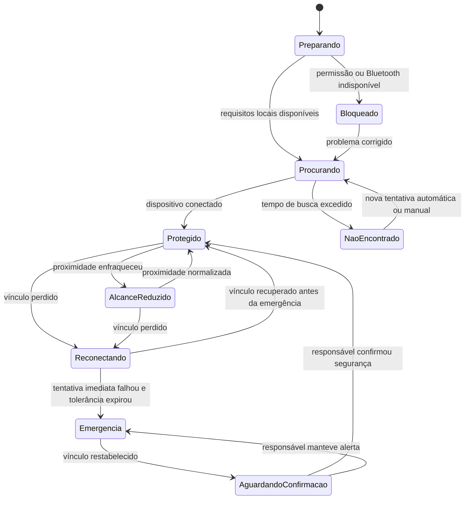
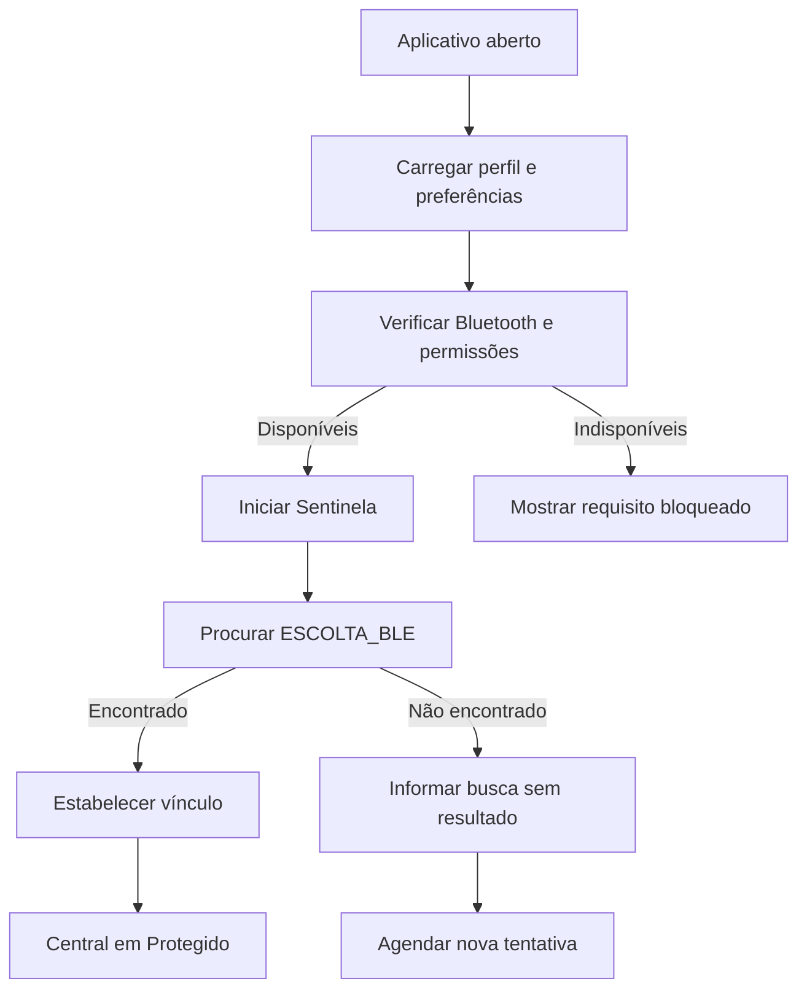
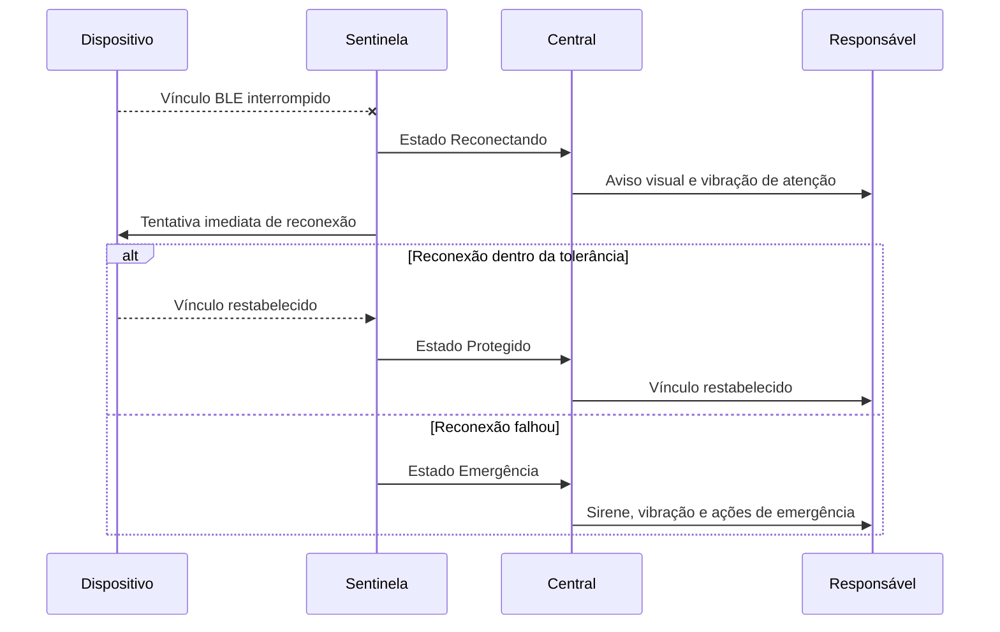
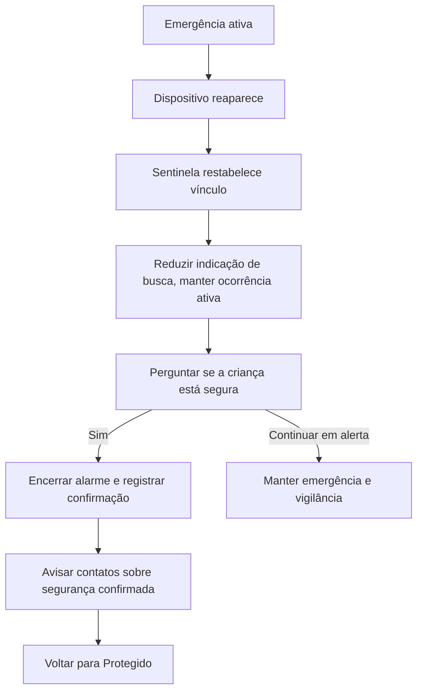

# Fluxos do Protótipo — Central e Sentinela

**Protótipo funcional:** Escolta UNITAU  
**Versão:** 1.0 — definição funcional inicial  
**Data:** 29 de julho de 2026  
**Documento relacionado:** `ESPECIFICACAO_PRODUTO_ESCOLTA_UNITAU.md`

## 1. Objetivo

Este documento detalha o comportamento da Central e da Sentinela antes do redesenho e da implementação. Ele define o que o usuário vê, o que o sistema faz, quais mensagens aparecem e como cada estado pode evoluir.

O objetivo é impedir que decisões críticas de segurança sejam tomadas de forma improvisada durante o desenvolvimento.

## 2. Responsabilidades

### 2.1 Central

A Central comunica o estado atual da proteção e apresenta a ação mais importante para aquele momento.

Ela deve responder imediatamente a quatro perguntas:

1. O Escolta está funcionando?
2. Qual criança está sendo monitorada?
3. Qual é a distância estimada?
4. Preciso fazer alguma coisa agora?

### 2.2 Sentinela

A Sentinela executa a vigilância automática:

- inicia a busca quando permitido;
- conecta ao dispositivo;
- acompanha o vínculo BLE;
- interpreta mudanças de proximidade;
- tenta recuperar interrupções;
- declara emergência quando a recuperação falha;
- continua procurando durante a emergência;
- solicita confirmação humana após o restabelecimento.

## 3. Princípios do fluxo

- O usuário nunca deve precisar adivinhar se o sistema está monitorando.
- Ações automáticas devem ser informadas sem exigir interação desnecessária.
- Um problema recuperável não deve ser apresentado imediatamente como emergência.
- Uma emergência não deve desaparecer apenas porque houve uma reconexão momentânea.
- O sistema deve informar falhas de permissão, Bluetooth, internet e serviços externos separadamente.
- O alarme local não deve depender de internet.
- Distância em metros deve ser identificada como estimativa.
- RSSI permanece restrito à Telemetria.

## 4. Máquina de estados principal



## 5. Prioridade dos estados

Quando mais de uma condição existir, a Central mostrará o estado de maior prioridade.

| Prioridade | Estado | Motivo |
| ---: | --- | --- |
| 1 | Emergência | Exige ação imediata. |
| 2 | Aguardando confirmação | O vínculo voltou, mas a segurança ainda não foi confirmada. |
| 3 | Reconectando | O vínculo foi interrompido e está em recuperação. |
| 4 | Bloqueado | O monitoramento não pode funcionar por falta de requisito local. |
| 5 | Alcance reduzido | O vínculo existe, mas a proximidade está enfraquecendo. |
| 6 | Procurando | A Sentinela está buscando o dispositivo. |
| 7 | Protegido | Operação normal. |

Uma falha de internet não substitui o estado de proteção local. Se o BLE estiver funcionando e a internet não, a Central continua como Protegido e mostra um aviso secundário sobre alertas remotos indisponíveis.

## 6. Fluxo de abertura do aplicativo

### 6.1 Usuário autenticado e conexão automática ativa



### 6.2 Comunicação da Central

Durante a preparação:

> Preparando proteção  
> A Sentinela está verificando o sistema.

Durante a busca:

> Procurando Escolta  
> Mantenha o Bluetooth ativado e o dispositivo próximo.

Após conexão:

> Protegido  
> Sofia está por perto.  
> Distância estimada: ~4 m

### 6.3 Falhas locais

#### Bluetooth desligado

> Bluetooth desativado  
> Ative o Bluetooth para que a Sentinela possa localizar o dispositivo.

Ação principal: **Abrir configurações**.

#### Permissão negada

> Permissão necessária  
> O Android bloqueou o acesso ao Bluetooth. Permita o acesso para iniciar a proteção.

Ação principal: **Revisar permissões**.

#### Dispositivo não encontrado

> Escolta não encontrado  
> Verifique se o dispositivo está ligado e próximo. A Sentinela tentará novamente.

Ações:

- **Tentar agora**;
- **Ver orientações**.

O estado “não encontrado” durante a abertura não deve disparar emergência, pois ainda não existia uma sessão de proteção confirmada.

## 7. Fluxo protegido

### 7.1 Informações da Central

Ordem de leitura:

1. estado `Protegido`;
2. nome da criança;
3. núcleo animado verde;
4. distância estimada;
5. Sentinela ativa;
6. última comunicação.

Exemplo:

> **PROTEGIDO**  
> Sofia está por perto  
> Distância estimada: ~4 m  
> Atualizado agora

### 7.2 Atualização da distância

- O valor visual não deve oscilar a cada amostra recebida.
- A interface deve acompanhar o valor filtrado fornecido pelo sistema.
- Mudanças pequenas podem ser suavizadas visualmente.
- O texto não deverá usar casas decimais.
- Valores fora de uma faixa confiável poderão ser substituídos por `Estimativa indisponível`.
- A classificação de segurança tem prioridade sobre o número mostrado.

### 7.3 Avisos secundários

Podem aparecer sem retirar o estado Protegido:

- internet indisponível;
- alertas remotos temporariamente indisponíveis;
- notificações bloqueadas pelo Android;
- localização desativada quando o compartilhamento estiver habilitado;
- volume do celular reduzido;
- preferência de conexão automática desligada.

Esses avisos devem indicar impacto e ação corretiva.

## 8. Fluxo de alcance reduzido

### 8.1 Entrada

O sistema entra em Alcance reduzido após a confirmação técnica já prevista na filtragem e no debounce. Uma única amostra fraca não deve alterar o estado visual.

### 8.2 Central

> **ALCANCE REDUZIDO**  
> Sofia pode estar se afastando  
> Distância estimada: ~8 m  
> Aproxime-se e observe o ambiente

Comportamento:

- núcleo amarelo;
- vibração curta no celular, se habilitada;
- aviso local sem sirene crítica;
- registro da mudança;
- nenhum push aos contatos confiáveis por padrão.

### 8.3 Saída

- Se a proximidade normalizar, voltar para Protegido e registrar a recuperação.
- Se o vínculo for perdido, entrar imediatamente em Reconectando.
- Se o contato optou por avisos de atenção, o envio externo é permitido, mas desligado por padrão.

## 9. Fluxo de perda e reconexão



### 9.1 Estado Reconectando

> **RECONECTANDO**  
> O vínculo com Sofia foi interrompido  
> A Sentinela está tentando restabelecer a proteção

Comportamento aprovado:

- tentativa de reconexão iniciada imediatamente;
- tolerância inicial sugerida de cinco segundos;
- núcleo azul em busca;
- vibração curta, distinta da emergência;
- nenhuma notificação externa neste primeiro momento;
- registro `Vínculo perdido`;
- se recuperar dentro da tolerância, registrar `Vínculo restabelecido`.

### 9.2 Falha da tentativa

Quando a tentativa imediata falhar e a tolerância expirar:

- mudar para Emergência;
- iniciar sirene e vibração crítica no celular;
- continuar procurando o dispositivo;
- registrar a emergência;
- capturar localização do celular somente se o compartilhamento estiver habilitado;
- iniciar envio aos contatos confiáveis quando a Rede de Proteção estiver disponível.

## 10. Fluxo de emergência

### 10.1 Central

> **EMERGÊNCIA**  
> Não foi possível restabelecer o vínculo com Sofia  
> Verifique a criança imediatamente

Elementos prioritários:

- núcleo vermelho;
- tempo desde a perda do vínculo;
- última distância estimada válida;
- horário da última comunicação;
- estado dos alertas externos;
- ações grandes e inequívocas.

### 10.2 Ações propostas

- **Continuar procurando** — informa que a Sentinela permanece ativa;
- **Ligar para contato** — abre a ligação para o contato escolhido;
- **Polícia 190**;
- **SAMU 192**;
- **Confirmar segurança** — inicia confirmação, sem encerrar por toque único.

### 10.3 Alarme

- Sirene e vibração permanecem durante a emergência.
- Sons informativos desativados não silenciam o alarme crítico.
- O aplicativo deve informar quando o volume ou as políticas do sistema puderem limitar o áudio.
- O comportamento em modo silencioso e Não Perturbe precisa ser validado no Android real antes de qualquer promessa.

### 10.4 Alerta aos contatos confiáveis

Mensagem inicial proposta:

> Emergência — Escolta UNITAU  
> O vínculo com o dispositivo de Sofia foi perdido e não pôde ser restabelecido. Verifique o responsável imediatamente.

Se localização estiver habilitada:

> Localização do celular responsável no início da emergência: [abrir mapa]

Nunca utilizar “localização da criança”.

## 11. Fluxo de restabelecimento após emergência



### 11.1 Confirmação

> **VÍNCULO RESTABELECIDO**  
> O dispositivo voltou a responder. Sofia está segura?

Ações:

- **Sim, está segura**;
- **Continuar em alerta**.

### 11.2 Encerramento

Após confirmação:

- interromper sirene e vibração;
- registrar nome do estado e horário;
- calcular duração da ocorrência;
- voltar para Protegido;
- enviar encerramento aos contatos confiáveis;
- mostrar confirmação breve.

Mensagem aos contatos:

> Segurança confirmada  
> Sofia foi confirmada como segura pelo responsável às 16h23.

## 12. Fluxo de confirmação manual durante emergência

Se o responsável tocar em Confirmar segurança antes da reconexão:

> **Encerrar emergência?**  
> O dispositivo ainda não está conectado. Confirme somente se você localizou Sofia e verificou que ela está segura.

Ações:

- **Voltar à emergência**;
- **Localizei e está segura**.

Após confirmar sem vínculo:

- encerrar sirene local;
- manter a Sentinela procurando em segundo plano enquanto permitido;
- apresentar estado `Segurança confirmada — dispositivo desconectado`;
- não apresentar `Protegido` até recuperar o vínculo;
- registrar que a confirmação ocorreu sem conexão;
- avisar contatos sobre a confirmação e informar que o dispositivo continua desconectado.

## 13. Fluxo de internet e serviços externos

A proteção BLE local e a conectividade externa são estados independentes.

### 13.1 Sem internet, com BLE ativo

> Proteção local ativa  
> Alertas para contatos estão temporariamente indisponíveis.

- A Central permanece Protegido.
- O aviso aparece como condição secundária.
- A falha é registrada se ocorrer durante uma emergência.

### 13.2 Internet retorna

- Atualizar o estado secundário.
- Avaliar o envio de alertas pendentes apenas se ainda forem relevantes.
- Não enviar silenciosamente uma emergência antiga já encerrada sem indicar que se trata de um evento atrasado.

### 13.3 Falha parcial de envio

Se dois de três contatos receberam:

> Alertas enviados para 2 de 3 contatos.

A Central de emergência deverá permitir visualizar quem recebeu, quem está pendente e onde houve falha.

## 14. Fluxo de preferências críticas

### 14.1 Desativar conexão automática

> **Desativar conexão automática?**  
> A Sentinela não procurará o dispositivo sozinha. Será necessário iniciar a conexão manualmente, o que pode reduzir a proteção.

Ações:

- **Manter ativa**;
- **Desativar**.

### 14.2 Ativar localização

> **Compartilhar localização deste celular**  
> Durante uma emergência, seus contatos de confiança poderão receber a posição deste celular. Essa não é a localização exata da criança.

Após aceitar, solicitar a permissão do sistema operacional.

### 14.3 Desativar notificações

Se o usuário tentar bloquear notificações críticas:

> As notificações ajudam o Escolta UNITAU a avisar sobre interrupções e emergências. O alarme dentro do aplicativo poderá continuar, mas alertas fora da tela podem ser limitados.

A linguagem final dependerá do comportamento validado no Android.

## 15. Estrutura funcional da Central

```text
┌─────────────────────────────────────┐
│ ESCOLTA UNITAU          [Perfil]    │
│ Sentinela ativa                     │
├─────────────────────────────────────┤
│                                     │
│          NÚCLEO DE PROTEÇÃO         │
│                                     │
│             PROTEGIDO               │
│        Sofia está por perto         │
│                                     │
│     Distância estimada: ~4 m        │
│          Atualizado agora           │
│                                     │
├─────────────────────────────────────┤
│ Estado do sistema                   │
│ ● Vínculo ativo                     │
│ ● Alertas disponíveis               │
│ ● Sentinela monitorando             │
├─────────────────────────────────────┤
│ Central  Protocolo  Registros Sistema│
└─────────────────────────────────────┘
```

O wireframe é funcional, não visual. Proporções, cores, tipografia e animações serão definidos na etapa de design.

## 16. Regras de registro

Eventos que sempre geram registro:

- início da proteção;
- conexão estabelecida;
- alcance reduzido confirmado;
- recuperação para Protegido;
- perda de vínculo;
- início de reconexão;
- emergência;
- reconexão após emergência;
- confirmação manual;
- falha de alerta externo;
- alteração crítica de preferência.

Eventos de alta frequência, como cada amostra de RSSI ou cada tentativa interna, não devem poluir os Registros comuns. Eles podem existir apenas na Telemetria.

## 17. Casos extremos

### 17.1 Aplicativo aberto sem criança configurada

- Permitir configurar o perfil antes da busca automática.
- Não exibir mensagens com nome vazio.

### 17.2 Aplicativo aberto sem dispositivo previamente vinculado

- Entrar em fluxo inicial de localização e vínculo.
- Não tratar a ausência como emergência.

### 17.3 Bluetooth desligado durante proteção

- Entrar em Reconectando ou Bloqueado conforme a causa detectada.
- Explicar que o Bluetooth foi desativado.
- Após a tolerância, avaliar emergência, pois a proteção foi interrompida.

### 17.4 Usuário encerra o aplicativo

- O comportamento real deverá ser validado no Android.
- A interface não pode prometer monitoramento em segundo plano antes dessa validação.
- Se o sistema não puder continuar após encerramento forçado, isso deverá ser explicado no Protocolo e durante a proteção.

### 17.5 Celular reiniciado

- Preferências e registros devem persistir.
- A retomada automática dependerá das permissões e das capacidades validadas no Android.

### 17.6 Oscilação rápida de estados

- Respeitar filtragem, histerese e debounce.
- Evitar animações e notificações a cada amostra.
- Registrar apenas mudanças confirmadas.

## 18. Métricas para validação

Durante os testes futuros, registrar:

- tempo médio de conexão inicial;
- tempo médio de reconexão;
- taxa de reconexão dentro da tolerância;
- número de falsas emergências;
- número de mudanças falsas para Alcance reduzido;
- atraso entre perda confirmada e alarme;
- comportamento com tela ligada e apagada;
- comportamento em segundo plano;
- impacto do modo de economia de bateria;
- sucesso de notificações locais;
- sucesso de alertas externos;
- clareza percebida dos estados por usuários de teste.

## 19. Decisões confirmadas

- nome Escolta UNITAU;
- Sentinela como identidade da vigilância automática;
- conexão automática ao abrir;
- uma criança por conta;
- até três contatos de confiança;
- núcleo de proteção no lugar do radar;
- distância estimada visível em metros;
- RSSI restrito à área técnica;
- reconexão antes da emergência;
- confirmação humana após restabelecimento;
- tema escuro como padrão;
- contatos recebem emergências e encerramentos por padrão;
- localização do celular opcional e desativada por padrão;
- captura de localização somente ao declarar emergência;
- Android como prioridade, preservando possibilidade de iOS;
- Telemetria fora da navegação comum.

## 20. Pontos para validação antes da implementação

1. Confirmar cinco segundos como tolerância inicial de reconexão.
2. Definir duração e repetição da busca quando nenhum dispositivo foi previamente conectado.
3. Definir se manter tela ativa será padrão ou opção desligada.
4. Validar comportamento de áudio no modo silencioso e Não Perturbe.
5. Validar BLE com tela apagada, segundo plano e encerramento forçado.
6. Definir quando uma distância deixa de ser confiável e passa a aparecer como indisponível.
7. Definir retenção dos Registros.
8. Definir o comportamento do tema claro em situações de emergência.
